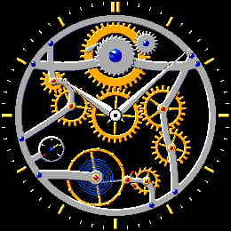
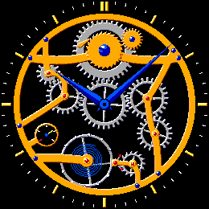
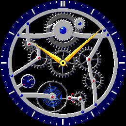

# Skeleton Watch

 

A Pebble watchface for the round watches: a see-through mechanical movement.
Gold wheels turn behind the hands, the balance wheel swings on its blued
hairspring, and at every beat the escapement lets the whole train tick forward
a step.

  

Built for **Pebble Round 2 (gabbro, 260x260)** and **Pebble Time Round (chalk,
180x180)**, round only. The movement is laid out for a circle: the barrel at
12, the balance at 7, the train down the right-hand side and the motion works
on the left.

## Using it

- **Flick your wrist**, or **tap the screen** on the Round 2, and the movement
  runs for 12 seconds: the balance swings, the pallet fork snaps from side to
  side, the escape wheel jumps half a tooth per beat and every wheel in the
  train steps forward with it.
- **Each minute** it runs for about 2 seconds as the hands move on, and for 6
  seconds when the face opens.
- The **power reserve** dial at 8 o'clock is the watch battery: the gold hand
  sweeps from the red tick (empty) clockwise round to full.
- The hands are faceted dauphine hands, lit from the upper left like the rest
  of the movement.

## Settings

| Setting | Default | Options |
|---|---|---|
| Finish | Classic: gold wheels, rhodium bridges | Gold (gold bridges, silver wheels), Steel (gunmetal wheels, navy chapter ring), Rose gold, Black (anthracite bridges, gold wheels) |
| Hands | Polished white | Blued steel, Gold |
| When it ticks | On a flick or tap, and briefly each minute | All the time (uses much more battery); Never (one tick a minute) |

## Battery

The face redraws only while the movement runs, at 25 fps: about 2 s each
minute, 12 s after a flick or tap, then nothing until the next minute. A frame
takes 3-4 ms to draw in the emulator. *All the time* keeps the frame timer
running constantly and will drain the watch much faster; *Never* draws once a
minute and moves the train on one beat each time. Touch is subscribed on the
Round 2 for the tap.

## How it works

- **Gears as loops.** Turning a rendered sprite on the watch is unusable
  (`graphics_draw_rotated_bitmap` gets an app killed), but a gear looks the same
  after turning one tooth. `tools/make_art.py` draws each wheel's toothed rim six
  times, each turned a sixth of a tooth further under the *same* light (from
  the upper left), so frame 5 runs straight into frame 0 and the rim loops
  however far the wheel turns. The rims are supersampled 4x, bevel-shaded from
  a blurred height field, given concentric graining (which is the same at every
  angle, so it loops too) and stored as run-length sheets of colour roles.
- **Spokes in code.** Spokes don't repeat every tooth, so the watch draws them
  (`spoke()` in `movement.c`: shadow, lit edge and face, as three bars) at the
  wheel's true angle, under the rim. The rim frame and the spoke angle come from
  the same position, so they never drift apart.
- **Meshing.** Each wheel sits m(N₁+N₂)/2 from the wheel it meshes (m is the
  module) and gets a starting phase that puts one of its gaps on the other
  wheel's tooth at the contact point:
  `phase = (β+π)·N₂/2π − ½ − phase₁ + β·N₁/2π` (in teeth, β the direction from
  wheel 1 to wheel 2). Meshing wheels pass the same number of teeth, so they
  stay interlocked as they turn. `check_mesh()` renders every meshing pair
  through a full tooth and stops the build if they ever overlap.
- **Escapement.** The balance swings at 600 ms a period (`AMP_DEG` 80°). Each
  time it passes the centre is a beat: the escape wheel moves on half a tooth,
  the train a quarter of a tooth, both eased over 90 ms, and the pallet fork
  snaps 9° to the other side. The hairspring is an Archimedean spiral pinned at
  the stud and turned with the balance at the collet, so it breathes. The
  movement's own clock only runs while it is animating, and frames are paced
  by the real clock with silly `time_ms()` deltas ignored.
- **The rest of the movement** (bridges, ratchet and crown wheel, click,
  jewels, blued screws, chapter ring, power reserve dial) never moves, so it
  is one pre-shaded overlay drawn over the wheels. The bridges are one union,
  so their polished bevels run into each other.
- **Drawing.** `src/c/gfx.c` is a small software rasteriser that writes into the
  captured framebuffer (per-row spans from `gbitmap_get_data_row_info`, which
  is what makes the round screens work), with sub-pixel polygons and discs for
  the code-drawn parts. Finishes are tables of colours for the art's roles
  (`palette.c`), so they cost no extra art.
- **Memory.** The art blob is loaded into RAM: 39 KB on gabbro (82 KB of heap
  left) and 23 KB on chalk (33 KB left).

## Building and testing

```bash
npm install                    # @rebble/clay
python3 tools/make_art.py      # resources/data/art~<platform>.bin + src/c/layout_gen.h (--preview for art/preview/)
pebble build
pebble install --emulator gabbro
python3 tools/shot.py gabbro /tmp/shot.png    # screenshot via the QEMU monitor
~/.local/share/uv/tools/pebble-tool/bin/python tools/send_setting.py Finish=1 Hands=1
```

`make_art.py` owns the layout: gear positions, tooth counts, bridges and
jewels are at the top of it, and it regenerates `src/c/layout_gen.h` so the C
side always matches the art.

Debug build flags (environment variables, picked up by `wscript`):

| Flag | Effect |
|---|---|
| `SKEL_SHOW_TIME=1008` | Clock starts at 10:08 (the emulator ignores clock changes) |
| `SKEL_FAST=10` | A "minute" lasts 10 s |
| `SKEL_DEBUG=1` | Frame draw time (this / worst) and free heap on screen |

Rebuild with no flags before releasing.

**Mac harness.** `tools/host/run.sh <platform> <out_dir> <HH:MM> [events]` builds
the real movement code against a stub `pebble.h` and renders frames, a contact
sheet and a GIF. Events: `w<ms>` run, `s` still, `p` flick, `m` next minute,
`t<HH:MM>` set the time, `f<k>` finish, `h<k>` hands, `M<k>` motion, `b<pct>`
battery. For example `tools/host/run.sh gabbro /tmp/sk 10:08 f4 p w3000`
films three seconds of the Black finish ticking.

## Store assets

`python3 tools/store_assets.py` renders the whole `store/` set from the harness
(identical to the emulator; the face uses no system font):

| File | Shows |
|---|---|
| `<platform>_1_preview.gif` | At rest, then a flick sets it ticking (8 s, real speed) |
| `<platform>_2_time.png` | 10:08, Classic finish |
| `<platform>_3_ticking.png` | Mid-swing, Black finish |
| `<platform>_4_gold.png` | Gold finish, blued hands |
| `<platform>_5_steel.png` | Steel finish, gold hands |
| `reddit_gabbro.gif` | The gabbro preview at 2x |
| `icon_80x80.png`, `icon_144x144.png` | `pebble publish` icons |
| `banner_720x320.png` | Store header |
| `description.md` | Short and full store text |

## Publishing

Not published yet. The first release:

```bash
pebble build
pebble publish --non-interactive --no-gif-all-platforms \
  --name "Skeleton Watch" \
  --description "A see-through mechanical movement: gears turn behind the hands and the balance ticks." \
  --icon-small store/icon_80x80.png --icon-large store/icon_144x144.png \
  --release-notes "First release." \
  --screenshots store/gabbro_*.{gif,png} store/chalk_*.{gif,png}
```

Publishing goes live immediately. Then paste the full description from
`store/description.md` and upload the banner on the developer dashboard.

## Testing status

Checked in the emulator on gabbro and chalk: the movement runs after launch
and a flick and then stops (CPU back to idle, identical frames), and a
settings message changes the finish and hands live. The Mac harness renders
every finish on both. Untested on real hardware; touch is untested (the
emulator can't inject it) and the Clay settings page has not been opened.
